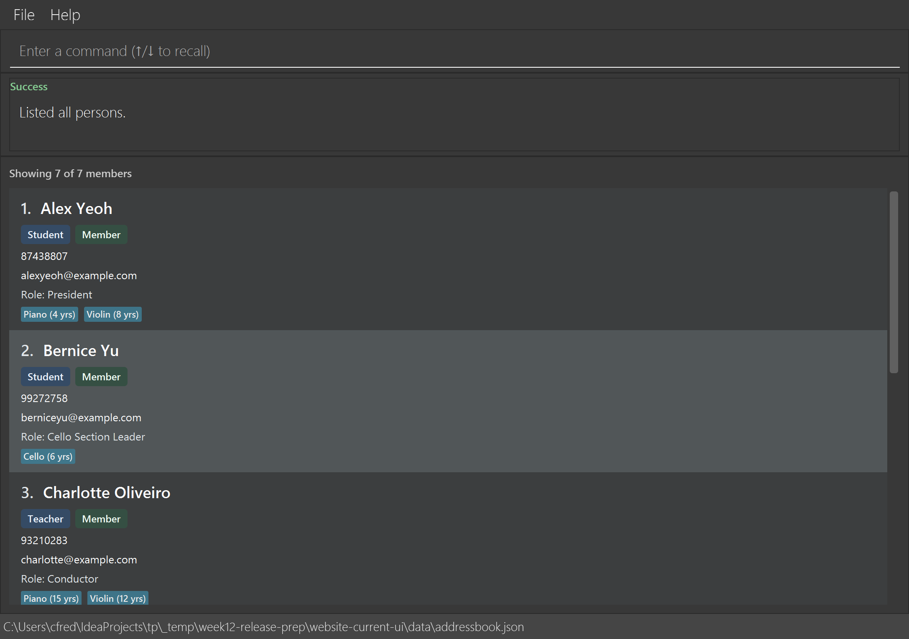

# HiveMind

HiveMind is a desktop directory for music CCA coordinators to manage members and alumni. It combines fast commands with a graphical display of contact details, membership status, member type, optional roles, instruments and years of experience, and participation groups.

Add, edit, delete, find, filter and sort members; import CSV records or export selected fields from the displayed results. Undo and redo recent changes, and recall commands with the Up and Down arrow keys. Successful changes are saved automatically beside the JAR.

Use **Java 25** to run a downloaded release with `java -jar HiveMind.jar`.

* [Download a release](https://github.com/AY2627S1-CS2103T-T10-3/tp/releases)
* [User Guide](https://ay2627s1-cs2103t-t10-3.github.io/tp/UserGuide.html)
* [Developer Guide](https://ay2627s1-cs2103t-t10-3.github.io/tp/DeveloperGuide.html)
* [Project team](https://ay2627s1-cs2103t-t10-3.github.io/tp/AboutUs.html)

This project is based on the AddressBook-Level3 project created by the [SE-EDU initiative](https://se-education.org).
