* Table of Contents
{:toc}

--------------------------------------------------------------------------------------------------------------------

## **Acknowledgements**

* _{List the sources of reused or adapted ideas, code, documentation, and third-party libraries here, with links to the originals.}_

--------------------------------------------------------------------------------------------------------------------

## **Setting up, getting started**

Refer to the guide [_Setting up and getting started_](SettingUp.md).

--------------------------------------------------------------------------------------------------------------------

## **Design**

<div markdown="span" class="alert alert-primary">

:bulb: **Tip:** The `.puml` files used to create diagrams are in `docs/diagrams`. Refer to the [_PlantUML Tutorial_ at se-edu/guides](https://se-education.org/guides/tutorials/plantUml.html) to learn how to create and edit diagrams.
</div>

### Architecture


The ***Architecture Diagram*** given above explains the high-level design of the App.

The following provides a quick overview of the main components and their interactions.

**Main components of the architecture**

**`Main`** (consisting of classes [`Main`](https://github.com/AY2627S1-CS2103T-T10-3/tp/blob/master/src/main/java/seedu/address/Main.java) and [`MainApp`](https://github.com/AY2627S1-CS2103T-T10-3/tp/blob/master/src/main/java/seedu/address/MainApp.java)) is in charge of the app launch and shut down.
* At app launch, it initializes the other components in the correct sequence, and connects them up with each other.
* At shut down, it shuts down the other components and invokes cleanup methods where necessary.

The bulk of the app's work is done by the following four components:

* [**`UI`**](#ui-component): The UI of the App.
* [**`Logic`**](#logic-component): The command executor.
* [**`Model`**](#model-component): Holds the data of the App in memory.
* [**`Storage`**](#storage-component): Reads data from, and writes data to, the hard disk.

[**`Commons`**](#common-classes) represents a collection of classes used by multiple other components.

**How the architecture components interact with each other**

The *Sequence Diagram* below shows how the components interact with each other for the scenario where the user issues the command `delete 1`.


Each of the four main components (also shown in the diagram above),

* defines its *API* in an `interface` with the same name as the Component.
* provides its functionality through a concrete `{Component Name}Manager` class that implements the corresponding API interface.

For example, the `Logic` component defines its API in `Logic.java` and implements it in `LogicManager.java`. Other components interact with a component through its interface rather than its concrete class, preventing them from coupling to that component's implementation, as illustrated in the following partial class diagram.


The sections below give more details of each component.

### UI component

The **API** of this component is specified in [`Ui.java`](https://github.com/AY2627S1-CS2103T-T10-3/tp/blob/master/src/main/java/seedu/address/ui/Ui.java)


The UI consists of a `MainWindow` and its parts, such as `CommandBox`, `ResultDisplay`, `PersonListPanel`, and `StatusBarFooter`. All of these, including `MainWindow`, inherit from the abstract `UiPart` class, which captures common behavior among classes that represent visible GUI parts.

The `UI` component uses the JavaFX UI framework. The layouts of these UI parts are defined in matching `.fxml` files in `src/main/resources/view`. For example, [`MainWindow.fxml`](https://github.com/AY2627S1-CS2103T-T10-3/tp/blob/master/src/main/resources/view/MainWindow.fxml) specifies the layout of [`MainWindow`](https://github.com/AY2627S1-CS2103T-T10-3/tp/blob/master/src/main/java/seedu/address/ui/MainWindow.java).

The `UI` component,

* executes user commands using the `Logic` component.
* listens for changes to `Model` data so that the UI can be updated with the modified data.
* keeps a reference to the `Logic` component, because the `UI` relies on the `Logic` to execute commands.
* depends on some classes in the `Model` component because it displays `Person` objects from the model.

#### Member cards

`PersonListPanel` observes the filtered and sorted person view exposed by `Logic`. Its list cells create a `PersonCard` for each displayed person, passing the cell's one-based index. When `find`, `filter`, `sort`, or `list` changes the displayed results, the list updates the cards and their indices. The existing UI class diagram shows this relationship; the card enhancement adds no new classes or dependencies.

`PersonCard` loads `PersonListCard.fxml` through `UiPart`. The FXML `fx:id` attributes match the controller's `@FXML` fields. The constructor reads the person's public getters to populate the name, contact details, membership status, member type, optional role, and instruments. Type and status use the model's keyword strings. Instrument labels use `Instrument.toDisplayString()` and are sorted by name, ignoring case.

When no role is recorded, the role label has both `visible` and `managed` set to `false`: it is hidden and does not reserve layout space. Name, contact, and role labels allow text wrapping, while flow panes allow the membership details and instrument labels to move onto additional rows as space narrows. These changes affect presentation only; the model and stored records are unchanged.

`PersonCardTest` loads the actual FXML and checks field values, all status/type combinations, role visibility and layout participation, empty instruments, and instrument ordering. It runs on the JavaFX application thread and requires a working graphical session. Enable it with the environment variable `HIVEMIND_UI_TESTS=true`; otherwise JUnit skips this test class so the existing headless CI remains usable. On Linux/macOS, run:

```sh
HIVEMIND_UI_TESTS=true ./gradlew test --tests seedu.address.ui.PersonCardTest --rerun-tasks
```

On Windows PowerShell, set `$env:HIVEMIND_UI_TESTS = "true"` and run `./gradlew.bat test --tests seedu.address.ui.PersonCardTest --rerun-tasks`. These tests do not replace visual checks for wrapping and scrolling; use the member-card scenarios in the manual-testing section below.

### Logic component

**API** : [`Logic.java`](https://github.com/AY2627S1-CS2103T-T10-3/tp/blob/master/src/main/java/seedu/address/logic/Logic.java)

Here's a (partial) class diagram of the `Logic` component:


The sequence diagram below illustrates the interactions within the `Logic` component, taking `execute("delete 1")` API call as an example.


<div markdown="span" class="alert alert-info">:information_source: **Note:** The lifeline for `DeleteCommandParser` should end at the destroy marker (X), but due to a limitation of PlantUML, it continues to the end of the diagram.
</div>

How the `Logic` component works:

1. When `Logic` is called upon to execute a command, the command is passed to an `AddressBookParser` object, which in turn creates a parser that matches the command (e.g., `DeleteCommandParser`) and uses it to parse the command.
1. This results in a `Command` object (more precisely, an object of one of its subclasses e.g., `DeleteCommand`) which is executed by the `LogicManager`.
1. The command can communicate with the `Model` when it is executed (e.g. to delete a person).<br>
   Note that although this is shown as a single step in the diagram above for simplicity, the code can require several interactions between the command object and the `Model` to complete the operation.
1. The result of the command execution is encapsulated as a `CommandResult` object which is returned from `Logic`.

The parser class diagram below uses `add` as one example of how HiveMind parses commands. It focuses on the Logic parser classes; the member fields are described in the text below rather than drawing the Model classes here:

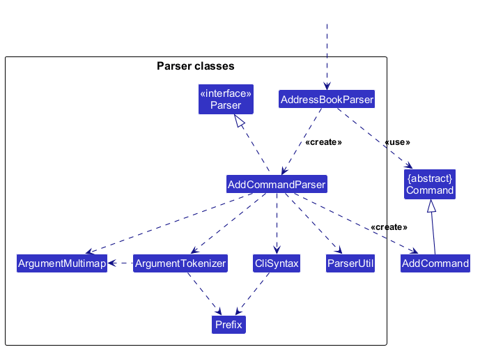

How the parsing works:
* `AddressBookParser` creates an `AddCommandParser` for `add`. The parser tokenizes prefixes into an `ArgumentMultimap` and checks that `n/`, `p/`, `e/`, and `s/` are present.
* `ParserUtil` validates the status, member type, optional role, instruments, and participation groups. When `ty/` is omitted, `AddCommandParser` uses `student`; when `r/` is omitted, the person's role is empty. Repeated `g/` prefixes add groups to the person's group set.
* `AddCommandParser` creates a `Person` from the parsed values, then an `AddCommand` containing that person. `AddressBookParser` returns it as a `Command` to `LogicManager`.
* Other command parsers follow the same `Parser` interface, although their accepted prefixes and validation rules differ.

### Model component
**API** : [`Model.java`](https://github.com/AY2627S1-CS2103T-T10-3/tp/blob/master/src/main/java/seedu/address/model/Model.java)

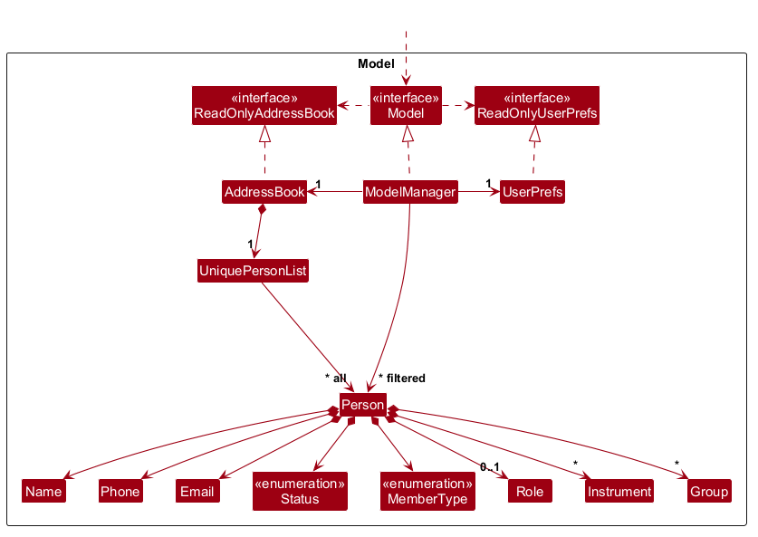


The `Model` component,

* stores the address book data i.e., all `Person` objects (which are contained in a `UniquePersonList` object).
* maintains a `FilteredList<Person>` view of the directory and a `SortedList<Person>` view of those filtered results. It exposes the sorted view as an unmodifiable `ObservableList<Person>` that the UI can observe and bind to, so the UI updates when membership or ordering changes.
* stores a `UserPrefs` object that represents the user’s preferences (currently, just the GUI settings). This is exposed to the outside as a `ReadOnlyUserPrefs` object.
* does not depend on any of the other three components (as the `Model` represents data entities of the domain, they should make sense on their own without depending on other components)


### Storage component

**API** : [`Storage.java`](https://github.com/AY2627S1-CS2103T-T10-3/tp/blob/master/src/main/java/seedu/address/storage/Storage.java)

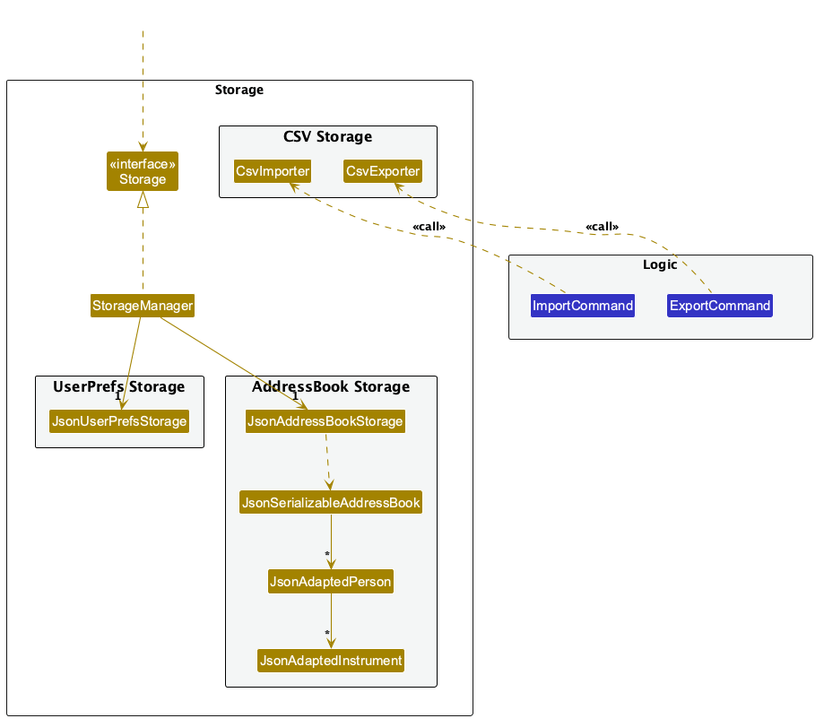

The `Storage` component,
* can save both address book data and user preference data in JSON format, and read them back into corresponding objects.
* is implemented by `StorageManager`, which delegates the actual JSON file access to `JsonAddressBookStorage` and `JsonUserPrefsStorage` (one class per data file).
* depends on some classes in the `Model` component (because the `Storage` component's job is to save/retrieve objects that belong to the `Model`)

`JsonAdaptedPerson` rejects null group entries and names for which `String.isBlank()` returns true. For each remaining entry, it skips the membership if `Group.isValidName()` returns false. This omits Unicode-whitespace-only names such as `"\u00A0"` while preserving the person and valid groups. Valid names are constructed as `Group` objects, which replace runs of Unicode whitespace with one ordinary space and trim the result.

`JsonAdaptedPerson` also skips instrument entries whose names are not blank according to `String.isBlank()` but normalize to empty. Remaining instrument names are compared ignoring case and normalized Unicode whitespace. If old entries collapse to the same instrument name, the loader keeps the highest years of experience. These migrations preserve the member's record ID and other fields; loading does not rewrite the file.

This loading rule applies only to saved JSON data. Command parsing rejects every group name that normalizes to empty. Loading does not rewrite the data file, and successfully loaded records remain editable and saveable. The next successful command requiring a save writes the directory without the skipped memberships.

### Common classes

Classes used by multiple components are in the `seedu.address.commons` package.

--------------------------------------------------------------------------------------------------------------------

## **Implementation**

This section describes some noteworthy details on how certain features are implemented.

### Adding members and record identity

`AddCommandParser` validates the required name, phone, email and status, defaults an omitted type to `student`, and constructs a `Person`. `Name` accepts Unicode letters, combining accents and numbers, ordinary spaces, apostrophes, hyphens and full stops; the first character must be a letter or number. Prefix separators such as `/` remain invalid in names.

`AddCommand` checks the complete directory for a case-insensitive name match or an exact phone-number match. It adds a warning line for each matching record and still adds the new member, as specified by UC01. `LogicManager` saves the resulting directory before returning the warnings and success message; its existing rollback restores the directory if saving fails.

Each `Person` has a stable UUID record ID, independent of editable contact details. `Person.isSamePerson` compares IDs, while `Person.equals` compares recorded details for snapshot and CSV data comparisons. `UniquePersonList` checks, replaces and removes records by ID. `EditCommand` retains the selected person's ID, so identical names or even identical details never make an edit or deletion target another record. Sorting caches source positions by ID for the same reason.

`JsonAdaptedPerson` saves the ID with the other fields and restores it on load. Older files without IDs receive fresh IDs as they load, which are written on the next successful data change. Malformed or repeated IDs are invalid data. Undo snapshots retain the same IDs because they copy the immutable person records.

**Design choice:** Record IDs allow legitimate shared names and phone numbers without treating editable contact details as permanent identity. They add one internal JSON field but require no new user command or confirmation step. CSV keeps its existing eight columns and receives new record IDs on import. Since CSV has no IDs, `ImportCommand` rejects records with identical recorded details against the existing directory or earlier CSV rows, while allowing shared names with differing details.

### Participation groups

`Group` stores a non-blank name and normalizes whitespace before comparing names ignoring case. `ParserUtil.parseGroups` builds a set, so repeating `g/Choir g/choir` records one group. `add` may omit all groups. `edit` preserves groups unless `g/` is supplied; named groups replace the entire set, and a single empty `g/` clears it. An empty value mixed with named groups is rejected.

For older JSON files, `JsonAdaptedPerson` omits a Unicode-space-only group that earlier versions accepted, preserving the member and its remaining groups. New commands still reject such blank group names; null and previously invalid blank JSON group entries remain invalid data.

`Person` keeps a defensive copy of its group set and exposes an unmodifiable view. JSON saves group names and defaults a missing groups field to an empty set for older files. `PersonCard` renders sorted group names as separate, wrapping labels below a `Groups:` heading. The whole section is hidden and unmanaged when empty. This keeps a group containing a comma distinguishable from multiple groups. Instrument and group badges are constrained to their flow pane's width, and list cells follow the viewport width so long values wrap within the card.

### Partial-name search

The `find` command matches any part of a person's name, ignoring case. For example, `find ali` matches `Alice Tan`. Multiple whitespace-separated keywords use OR: a person is included when at least one keyword matches. Only the name is searched.

`FindCommandParser` rejects empty arguments and splits valid arguments into keywords. It constructs a `FindCommand` containing a `NameContainsKeywordsPredicate`. When executed, the command passes the predicate to `ModelManager.updateFilteredPersonList`, which updates the predicate of the JavaFX `FilteredList`. The UI observes the wrapping `SortedList` and displays the matching persons in the selected order with indices starting at 1; the underlying address book remains unchanged.

The following two sequence diagrams trace a successful `find ali` command. Parsing and execution are shown separately so the labels remain readable at the guide's width.

First, `LogicManager` calls `AddressBookParser.parseCommand`, which returns the parsed command `f` after creating its predicate `p`.

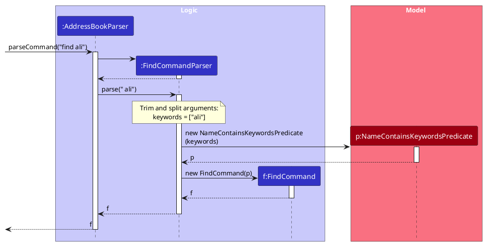

Execution then continues in `LogicManager`. The participant `m:Model` is implemented by `ModelManager`, and `p:Predicate` is the `NameContainsKeywordsPredicate` created during parsing. Setting the predicate evaluates the full directory, replacing any previous search or filter. The command uses the resulting list size for its feedback message and does not require a save. UI list-change notifications are omitted.

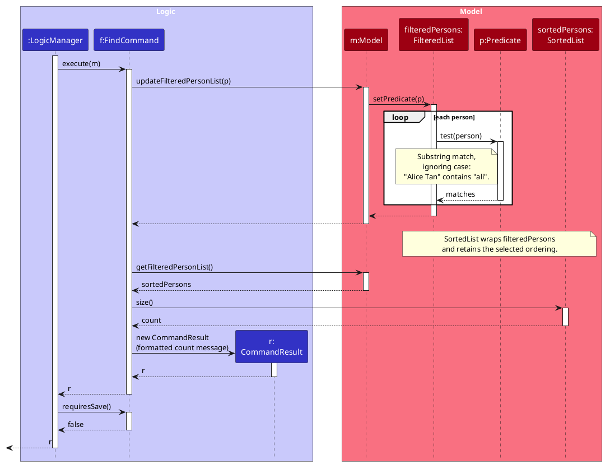

`NameContainsKeywordsPredicate` uses `StringUtil.containsSubstringIgnoreCase` for each keyword. The helper trims the keyword, rejects null, empty or multiple-word inputs, and normalises both strings with `Locale.ROOT` before checking for a substring. The original `containsWordIgnoreCase` helper retains its whole-word behaviour for other callers.

Tests in `StringUtilTest` cover substring positions, case differences, invalid inputs and non-matches. `NameContainsKeywordsPredicateTest` verifies name-only matching and OR semantics. `FindCommandTest` checks the resulting persons and feedback count, while `FindCommandParserTest` covers empty arguments and extra whitespace.

### Sorting displayed members

`SortCommandParser` accepts exactly one attribute, `name` or `status`, ignoring case and surrounding whitespace. `SortCommandParser` maps each keyword to a `SortKey` enum value holding its comparator. `SortCommand` passes that comparator to `Model.updateSortedPersonList`. Name sorting compares full names using `String.CASE_INSENSITIVE_ORDER`. Status sorting uses explicit ranks: `MEMBER`, `ACTIVE_ALUMNUS`, then `INACTIVE_ALUMNUS`, independently of enum declaration order.

`ModelManager` wraps its `FilteredList<Person>` in a `SortedList<Person>`. `getFilteredPersonList` exposes this sorted view to the UI and index-based commands, keeping displayed indices consistent with edit and delete. The model breaks comparator ties using cached directory positions keyed by record ID, so switching from name sorting still restores directory order within each status, including members with identical details. A source-list listener refreshes the cache before the filtered and sorted views process each directory change; comparisons use constant-time lookups. Stored records are not reordered, and `SortCommand.requiresSave` returns false.

Find/filter update the predicate without clearing the comparator. Add/edit retain sorting while restoring the full directory. `ListCommand` resets the predicate and clears the comparator to restore insertion order. A new model starts without a comparator, so sorting is session-only.

Sorting tests cover case-insensitive names, membership order, ties, switching ordering, filter/search transitions, empty results, list reset, add/edit/delete interactions and unchanged stored order. Parser tests cover case and whitespace, missing attributes, unsupported attributes and extra arguments.

### Status, instrument, type, role, and group filtering

`FilterCommandParser` accepts repeated `s/STATUS`, `i/NAME[:MIN_YEARS]`, `ty/TYPE`, `r/ROLE`, and `g/GROUP` arguments and requires at least one criterion. It validates statuses, member types, and roles through `ParserUtil.parseStatus`, `parseMemberType`, and `parseRole`. Groups use `ParserUtil.parseGroups`, reusing the same validation and deduplication as `add` and `edit`. Its `parseInstrumentCriterion` helper validates names through `ParserUtil.parseInstrumentName` and optional whole minimum years from 0 to 99. Name-only criteria default to a minimum of zero. Invalid minimum years use `InstrumentCriterion.MESSAGE_MINIMUM_YEARS_CONSTRAINTS`.

Before tokenizing, the parser reuses `ArgumentTokenizer.verifyNoUnknownPrefixes` with its five accepted prefixes. This replaces the separate unsupported-prefix check: `n/`, `p/`, and `e/` receive specific errors, while removed and wrong-case prefixes are rejected only before the first accepted prefix, matching `edit`. Ambiguous slash text inside values remains literal to preserve valid free text; field validation then applies as usual.

`FilterCommand` stores immutable sets of statuses, `InstrumentCriterion` values, member types, roles, and groups. Each instrument criterion has a normalized `name` and an explicit `minimumYears`. Its `matches(Instrument)` method checks the whole name through `Instrument.hasName` and an inclusive experience threshold on the same recorded instrument. `Instrument` continues to represent actual years played in member records and storage. `PersonMatchesFilterPredicate` checks the selected statuses and member types and delegates instrument matching to each criterion. Roles match complete names, ignoring case and surrounding whitespace, without changing `Role.equals`. A missing role fails an explicit role criterion. Groups match any recorded participation group using `Group.equals`, which ignores case and extra whitespace while matching the whole name. People without groups fail an explicit group criterion. Criteria within a field use OR, including repeated names with different minimums, and different fields use AND. An omitted field imposes no restriction, so status-only filters also include matching people without instruments, roles, or groups.

The command replaces the predicate on the full directory's `FilteredList`, reports its match count, and leaves stored records unchanged. `list` restores all records. Parser, predicate, and command tests cover repeated criteria, invalid inputs, threshold boundaries, matching years on the correct instrument, combined criteria, people without instruments or groups, group-name normalization and whole-name matching, empty results, and searches after earlier filters.

### Exporting current results

`AddressBookParser` delegates `export` to `ExportCommandParser`, which rejects arguments because the command takes none. When executed, `ExportCommand` obtains the current displayed results through `Model#getFilteredPersonList()` and passes them to `CsvExporter` with the `exports` directory. Exporting does not modify the model, so it does not save the address book or create an undo state.

`CsvExporter` creates CSV content with columns for name, phone, email, status, member type, role, instruments, and groups. Each field is quoted, with embedded quotation marks escaped. `CsvCellCodec` prefixes values that spreadsheet applications could interpret as formulas with a space. `CsvImporter` removes this prefix to preserve export/import round trips. `CsvExporter` sorts a person's instruments and groups by name and joins them with semicolons. `CsvListCodec` escapes semicolons and backslashes within each list value; `CsvImporter` decodes them before constructing instruments and groups. Empty results produce a file containing only the CSV header.

Before writing, `CsvExporter` finds the first unused filename in the form `current-results-XX.csv`, beginning with `current-results-01.csv`; existing exports are therefore preserved rather than overwritten. If file creation or writing fails, `ExportCommand` converts the `IOException` into a `CommandException`. Parser and exporter tests cover recognition of the command, normal and empty exports, and selecting the first available numbered filename while preserving existing files.

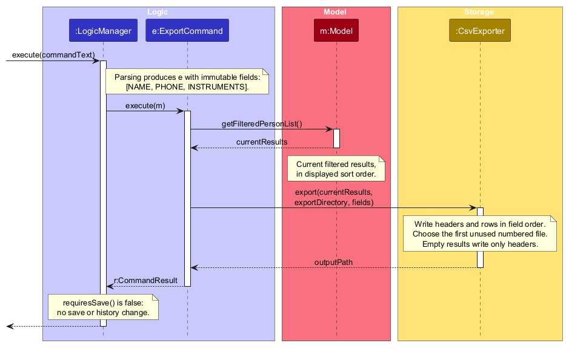

The following sequence diagram traces `filter s/member i/Violin:3 ty/teacher r/Conductor g/Chamber Orchestra`, using all five supported fields. Parsing creates a `FilterCommand` containing the criteria; executing that command creates the `PersonMatchesFilterPredicate` and applies it through `ModelManager.updateFilteredPersonList`. The participant `m:Model` is implemented by `ModelManager`.

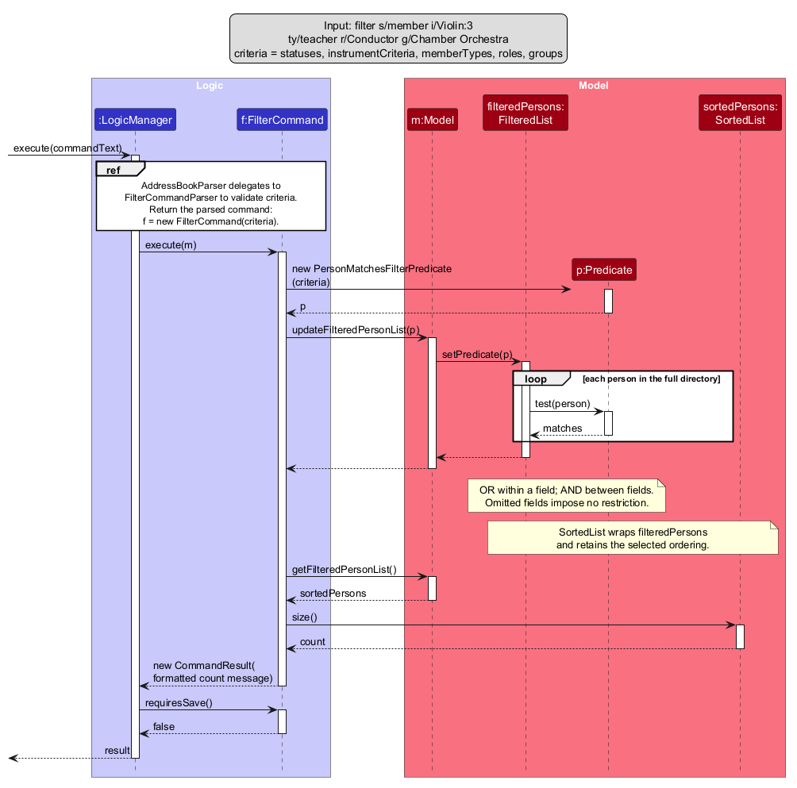

[Open the sequence diagram at full size](images/FilterSequenceDiagram.png). [PlantUML source](diagrams/FilterSequenceDiagram.puml). The diagram focuses on successful parsing and execution; model snapshots and UI list-change notifications are omitted.

### Importing people from CSV

`AddressBookParser` routes `import FILE_NAME` to `ImportCommandParser`. The parser accepts a non-empty `.csv` file name without path separators, so `ImportCommand` always resolves it inside the `imports` directory.

`ImportCommand` asks `CsvImporter.importPeopleWithLineNumbers` to read the entire CSV before changing the model. `CsvImporter` validates the required header and eight-column layout, then constructs `Person` objects using the existing model value objects such as `Name`, `Phone`, `Email`, `Status`, and `MemberType`. This reuses the application's validation rules instead of duplicating them in the CSV layer. It returns the complete imported list with each record's starting physical line number only when every row is valid, including records spanning multiple lines.

After parsing succeeds, `ImportCommand` copies the current address book and checks every imported person's recorded details against the copy before adding it. This detects identical records against both existing members and earlier CSV rows without mutating the model, while allowing different records to share names or phone numbers. Duplicate feedback identifies the person's name and starting physical line number. Only when all additions succeed does it replace the model's address book with the copy and show the full directory. Consequently, invalid CSV data and identical records fail the import atomically: the current directory and active filter remain unchanged.

The following sequence diagram focuses on a successful `ImportCommand.execute(...)` call. Command parsing, field-level CSV parsing, error handling, and `LogicManager`'s generic save-and-rollback handling are omitted; they do not affect the command's validate-then-replace behavior.

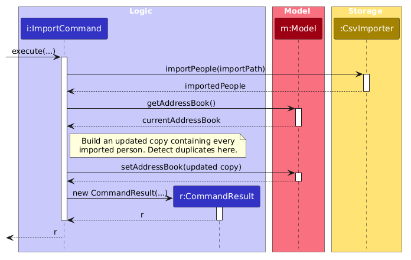

`ImportCommandTest` and `ImportCommandIntegrationTest` cover successful imports, duplicate handling, invalid data, malformed row layouts, optional fields, and atomic failures. `AddressBookParserTest` verifies that the command is recognised.

### Undo/redo feature

#### Implementation

The undo/redo mechanism is facilitated by `VersionedAddressBook`. It extends `AddressBook` with an undo/redo history, stored internally as an `addressBookStateList` and `currentStatePointer`. Additionally, it implements the following operations:

* `VersionedAddressBook#commit()` — Discards any undone states, then records the current address book state in its history, unless the data is unchanged.
* `VersionedAddressBook#undo()` — Reverts the most recent change by restoring an earlier state from its history.
* `VersionedAddressBook#redo()` — Restores the most recently undone state from its history.
* `VersionedAddressBook#canUndo()` and `VersionedAddressBook#canRedo()` — Return whether there is a change to revert or restore.
* `VersionedAddressBook#getUndoableCount()` and `VersionedAddressBook#getRedoableCount()` — Return how many changes can be reverted or restored one after another.

These operations are exposed in the `Model` interface as `Model#commitAddressBook()`, `Model#undoAddressBook()`, `Model#redoAddressBook()`, `Model#canUndoAddressBook()`, `Model#canRedoAddressBook()`, `Model#getUndoableChangeCount()` and `Model#getRedoableChangeCount()` respectively.

Given below is an example usage scenario and how the undo/redo mechanism behaves at each step.

Step 1. The user launches the application for the first time. The `VersionedAddressBook` will be initialized with the initial address book state, and the `currentStatePointer` pointing to that single address book state.

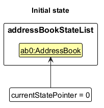

Step 2. The user executes `delete 5` command to delete the 5th person in the address book. `LogicManager` executes the command and, after the address book is saved to storage successfully, calls `Model#commitAddressBook()`, causing the modified state of the address book to be saved in the `addressBookStateList`, and the `currentStatePointer` is shifted to the newly inserted address book state.

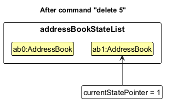

Step 3. The user executes `add n/David …​` to add a new person. `LogicManager` executes the command and, after a successful save, calls `Model#commitAddressBook()`, causing another modified address book state to be saved into the `addressBookStateList`.

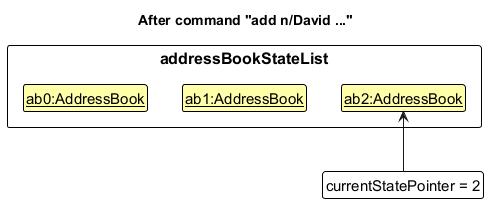

<div markdown="span" class="alert alert-info">:information_source: **Note:** No state is committed if the command fails or the save fails. If the save fails, `LogicManager` also restores the address book, the filtered list and the `currentStatePointer` to how they were before the command, so a failed `undo` leaves the history unchanged.

</div>

Step 4. The user now decides that adding the person was a mistake, and decides to undo that action by executing the `undo` command. The `undo` command calls `Model#undoAddressBook()`, which shifts the `currentStatePointer` once to the left, pointing it to the previous address book state, and restores the address book to that state. The full member list is then shown.

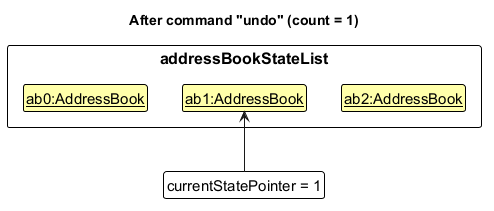

<div markdown="span" class="alert alert-info">:information_source: **Note:** If the `currentStatePointer` is at index 0, pointing to the initial address book state, then there is nothing to restore. The `undo` command uses `Model#getUndoableChangeCount()` to check if this is the case. If so, it will show "There is no change to undo." to the user.

</div>

The following sequence diagram shows how an undo operation goes through the `Logic` component:

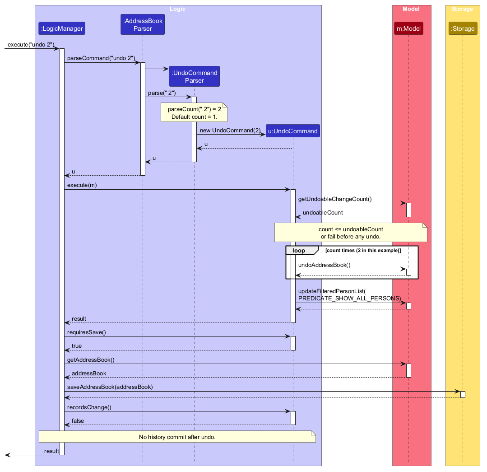

<div markdown="span" class="alert alert-info">:information_source: **Note:** The lifeline for `UndoCommand` should end at the destroy marker (X), but due to a limitation of PlantUML, it continues to the end of the diagram.

</div>

Similarly, how an undo operation goes through the `Model` component is shown below:

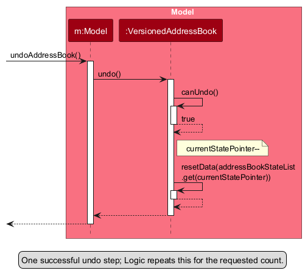

The `redo` command does the opposite: it calls `Model#redoAddressBook()`, which shifts the `currentStatePointer` once to the right, pointing to the previously undone state, and restores the address book to that state.

Both commands take an optional count, e.g. `undo 3`. `UndoCommandParser` and `RedoCommandParser` read a given count with `ParserUtil#parseCount()`, and use a count of 1 when none is given. The command first compares the count with `Model#getUndoableChangeCount()` (or `Model#getRedoableChangeCount()`). If the history is too short, it fails without changing anything, so the user is never left with only some of the requested changes undone. Otherwise it calls `Model#undoAddressBook()` (or `Model#redoAddressBook()`) once per step. `LogicManager` then saves the address book once. If that save fails, the rollback described in Step 3 restores the data and the `currentStatePointer` from before the command, so all of the steps are reverted together.

<div markdown="span" class="alert alert-info">:information_source: **Note:** If the `currentStatePointer` is at index `addressBookStateList.size() - 1`, pointing to the latest address book state, then there are no undone states to restore. The `redo` command uses `Model#getRedoableChangeCount()` to check if this is the case. If so, it shows "There is no undone change to redo." to the user.

</div>

Step 5. The user then decides to execute the command `list`. `list` does not change data, so `LogicManager` returns its result without saving or calling `Model#commitAddressBook()`. Thus, the `addressBookStateList` remains unchanged.

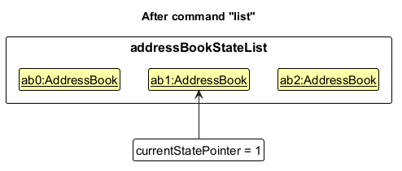

Step 6. The user executes `clear`. `LogicManager` executes the command and, after a successful save, calls `Model#commitAddressBook()`. Since the `currentStatePointer` is not pointing at the end of the `addressBookStateList`, all address book states after the `currentStatePointer` will be purged. Reason: it no longer makes sense to redo the `add n/David …​` command. This is the behavior that most modern desktop applications follow.

<div markdown="span" class="alert alert-info">:information_source: **Note:** The undone states are purged even if the command leaves the data unchanged (e.g. an `edit` that sets a field to its current value), because the user sees it reported as a new change. The undone states are kept only after commands that do not save data (e.g. `list`, as in Step 5) and after `undo` and `redo` themselves, which override `Command#recordsChange()` to return `false` so that `LogicManager` does not call `Model#commitAddressBook()` after them.

</div>

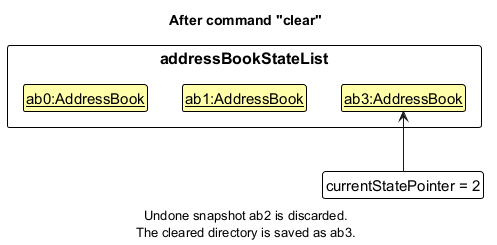

The following activity diagram summarizes what happens when a user executes a new command:

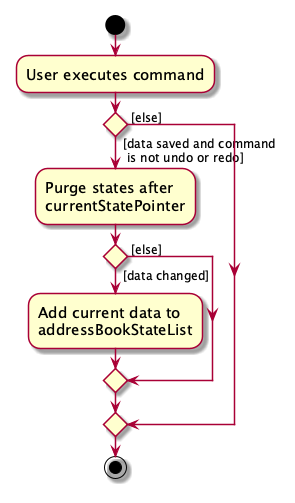

#### Design considerations:

**Aspect: How undo & redo execute:**

* **Alternative 1 (current choice):** Saves the entire address book.
  * Pros: Easy to implement.
  * Cons: May have performance issues in terms of memory usage.

* **Alternative 2:** Individual command knows how to undo/redo by itself.
  * Pros: Will use less memory (e.g. for `delete`, just save the person being deleted).
  * Cons: We must ensure that the implementation of each individual command is correct.

**Aspect: Where states are committed:**

* **Alternative 1 (current choice):** `LogicManager` commits after a successful save.
  * Pros: Failed saves never enter the history; new data-changing commands are undoable without extra code.
  * Cons: Relies on `commit()` comparing states to skip unchanged data. The comparison uses `AddressBook#hasIdenticalData`, not `equals`, because `Instrument` and `Group` equality ignores case, which would hide a capitalisation-only edit. It also relies on `undo` and `redo` opting out through `Command#recordsChange()`.

* **Alternative 2:** Each data-changing command calls `Model#commitAddressBook()` (the original AB3 proposal).
  * Pros: Explicit.
  * Cons: Easy to forget in new commands; a change is recorded even if saving it fails.

### \[Proposed\] Data archiving

_{Explain here how the data archiving feature will be implemented}_


--------------------------------------------------------------------------------------------------------------------

## **Documentation, logging, testing, dev-ops**

* [Documentation guide](Documentation.md)
* [Testing guide](Testing.md)
* [Logging guide](Logging.md)
* [DevOps guide](DevOps.md)

--------------------------------------------------------------------------------------------------------------------

## **Appendix: Requirements**

### Product scope

**Target user profile**:

* is a coordinator or executive committee member of a Music CCA
* manages the records of about 50–200 members and alumni of that CCA, including both students and teachers
* deals with membership that changes frequently (e.g., new intakes each semester, members graduating to become alumni)
* often needs to find suitable players for a piece or activity based on the instruments they play and how long they have played them
* prefers desktop apps over other types of applications
* can type fast, and prefers typing to mouse interactions
* is reasonably comfortable using CLI apps

**Value proposition**: HiveMind keeps a single, searchable directory of the contact details, membership status, roles and musical experience of a Music CCA's members and alumni. It lets the coordinator shortlist players for a piece or activity (e.g., "current members who have played trumpet for at least 3 years") in a single command, faster than scanning a spreadsheet or a typical mouse-driven GUI app.

**Out of scope**: HiveMind manages the directory of one CCA only. It does not handle event registration, attendance taking, or communication and mass messaging with members.


### User stories

Priorities: High (must have), Medium (nice to have), Low (unlikely to have)

| Story ID | Scenario | As a | I can | So that | Urgency |
| --- | --- | --- | --- | --- | --- |
| US01 | First use | first-time coordinator | explore representative sample records with guidance on key tasks | I can learn how HiveMind works without affecting real member information | Low |
| US02 | Second use | society coordinator | add a person with their name and contact details | I can maintain one reliable directory for the society | High |
| US03 | Second use | society coordinator | view everyone recorded in the directory | I can review all people affiliated with the society | High |
| US04 | Second use | society coordinator | view all recorded details for one person | I can retrieve their contact, membership, and musical information | High |
| US05 | Second use | society coordinator | update any recorded detail for a person | the directory remains accurate as information changes | High |
| US06 | Second use | society coordinator adopting an existing directory | import existing member information in bulk | I can transfer existing records without recreating every person manually | Medium |
| US07 | 10th use | society coordinator | record whether a person is a current member or an alumnus | I can distinguish present membership from past affiliation | High |
| US08 | 10th use | society coordinator | record whether a person is actively participating | I can identify current participants, including active alumni | High |
| US09 | 10th use | society coordinator | record whether a person is a student or teacher | I can distinguish players from potential instructors | Medium |
| US10 | 10th use | society coordinator | record a person's society role | I can identify people with particular responsibilities | Medium |
| US11 | 10th use | society coordinator | record the participation groups a person belongs to | I can identify the groups in which they are involved | Medium |
| US12 | 10th use | society coordinator | record all instruments a person plays | I can identify candidates for each musical part | High |
| US13 | 10th use | society coordinator | record a person's musical experience | I can assess their relevant musical background | Medium |
| US14 | 10th use | society coordinator | record a person's competency for each instrument | I can judge whether they can handle demanding parts | Medium |
| US15 | 10th use | society coordinator looking for a known person | search for them by name | I can retrieve their information quickly | High |
| US16 | 10th use | society coordinator | filter people by membership relationship and participation status | I can find current members, alumni, or active alumni without confusing the groups | High |
| US17 | 10th use | society coordinator seeking musical advice | filter people by student or teacher status | I can identify an appropriate instructor to approach | Medium |
| US18 | 10th use | society coordinator | filter people by society role | I can find people with a required responsibility | Medium |
| US19 | 10th use | society coordinator organising a group | filter people by participation group | I can find everyone involved in the relevant group | Medium |
| US20 | 10th use | society coordinator staffing a musical part | filter people by instrument | I can find candidates who play the required instrument | High |
| US21 | 10th use | society coordinator planning a piece | filter people by musical experience | I can find candidates with sufficient relevant background | Medium |
| US22 | 10th use | society coordinator planning a difficult piece | filter people by instrument competency | I can find candidates suited to the piece's difficulty | Medium |
| US23 | 10th use | society coordinator selecting people for an activity | apply several directory criteria together | I can produce a shortlist satisfying all relevant requirements | High |
| US24 | 100th use | long-term society coordinator | remove an obsolete or incorrectly added record | stale or incorrect information does not clutter or mislead me | High |
| US25 | 100th use | society coordinator who has identified a relevant group | export chosen details for the people in my current results | I can use a focused roster outside HiveMind without unrelated information | Medium |
| US26 | 100th use | society coordinator who made one or more mistakes | undo recent changes | I can recover from accidental edits or deletions without re-entering information | Medium |
| US27 | 100th use | society coordinator who undid a correct change | redo the undone change | I can restore it without entering the information again | Low |
| US28 | 100th use | society coordinator comparing members | sort directory results by a chosen recorded attribute | I can compare or browse people in an order useful to me | Low |
| US29 | After a prolonged break | returning society coordinator | access my previously saved records | I can continue managing the society without rebuilding the directory | High |
| US30 | After a prolonged break | returning society coordinator | access concise guidance for HiveMind's main functions | I can refresh my memory and resume work confidently | High |

### Use cases

**System:** HiveMind

**Use case:** UC01 - Add a member

**Actor:** Society coordinator

**MSS:**

1.  Society coordinator requests to add a member.
2.  HiveMind requests the member's name and contact details, and any membership or musical details to record.
3.  Society coordinator supplies the requested details.
4.  HiveMind adds the member to the directory and shows the saved record.

    Use case ends.

**Extensions:**

* 3a. HiveMind detects that a required detail is missing or a supplied detail is invalid.

    * 3a1. HiveMind shows an error message describing the problem.
    * 3a2. Society coordinator supplies corrected details.

      Steps 3a1-3a2 are repeated until the supplied details are valid.
      Use case resumes at step 4.

* 3b. HiveMind detects that the supplied name or phone number matches an existing record.

    * 3b1. HiveMind warns the society coordinator about each possible duplicate.

      Use case resumes at step 4.

* 4a. HiveMind cannot save the updated directory.

    * 4a1. HiveMind shows an error message informing the society coordinator that the new record was not saved.

      Use case ends.

**System:** HiveMind

**Use case:** UC02 - Update a member's details

**Actor:** Society coordinator

**MSS:**

1.  Society coordinator requests to update a member's recorded details.
2.  HiveMind requests the member to update and the details to change.
3.  Society coordinator identifies the member and supplies the new details, such as contact, membership, or musical information.
4.  HiveMind updates the supplied details, leaves other details unchanged, and shows the updated record.

    Use case ends.

**Extensions:**

* 3a. HiveMind detects that the selection is invalid or the member does not exist in the displayed list.

    * 3a1. HiveMind shows an error message and requests a valid selection.
    * 3a2. Society coordinator identifies a member in the displayed list.

      Steps 3a1-3a2 are repeated until the selection is valid.
      Use case resumes at step 4.

* 3b. HiveMind detects that no updated detail was supplied or a supplied detail is invalid.

    * 3b1. HiveMind shows an error message describing the problem.
    * 3b2. Society coordinator supplies corrected details.

      Steps 3b1-3b2 are repeated until the supplied details are valid.
      Use case resumes at step 4.

* 4a. HiveMind cannot save the updated directory.

    * 4a1. HiveMind shows an error message informing the society coordinator that the change was not saved.

      Use case ends.

**System:** HiveMind

**Use case:** UC03 - Delete a member

**Actor:** Society coordinator

**MSS:**

1.  Society coordinator requests to remove an obsolete or incorrectly added member record.
2.  HiveMind requests the member to remove.
3.  Society coordinator identifies the member in the displayed list.
4.  HiveMind removes the member's record from the directory and confirms which member was removed.

    Use case ends.

**Extensions:**

* 3a. HiveMind detects that the selection is invalid or the member does not exist in the displayed list.

    * 3a1. HiveMind shows an error message and requests a valid selection.
    * 3a2. Society coordinator identifies a member in the displayed list.

      Steps 3a1-3a2 are repeated until the selection is valid.
      Use case resumes at step 4.

* 4a. HiveMind cannot save the updated directory.

    * 4a1. HiveMind shows an error message informing the society coordinator that the deletion was not saved.

      Use case ends.

**System:** HiveMind

**Use case:** UC04 - Shortlist suitable players

**Actor:** Society coordinator

**MSS:**

1.  Society coordinator requests to shortlist suitable players.
2.  HiveMind requests the filtering criteria.
3.  Society coordinator supplies one or more criteria, such as status, instrument, or musical experience.
4.  HiveMind shows the members who satisfy the criteria.

    Use case ends.

**Extensions:**

* 3a. HiveMind detects that no criterion was supplied or a supplied criterion is invalid.

    * 3a1. HiveMind shows an error message describing the problem.
    * 3a2. Society coordinator supplies corrected criteria.

      Steps 3a1-3a2 are repeated until the supplied criteria are valid.
      Use case resumes at step 4.

* 4a. No member satisfies the criteria.

    * 4a1. HiveMind informs the society coordinator that no members were found.

      Use case ends.

### Non-Functional Requirements

1.  HiveMind should run on any _mainstream OS_ that has Java `25` or above installed.
2.  With a directory of up to 1,000 members, HiveMind should complete `list`, `find`, and `filter` operations within 2 seconds on a computer with a 2 GHz quad-core processor and 8 GB of RAM.
3.  A coordinator should be able to `add`, `edit`, `delete`, `list`, `find`, and `filter` operations using only the keyboard.
4.  HiveMind should display success or error feedback for each submitted command.
5.  Invalid syntax, field values, or displayed indices should produce an error explaining the rejection without changing member records.
6.  With a directories of up to 1,000 members, HiveMind should automatically save each change before reporting success, given that the local disk has sufficient free space.

### Glossary

* **Active alumnus**: An alumnus who still plays with the CCA (e.g., in alumni pieces or events).
* **Alumnus**: A former member of the CCA. An alumnus is either an _active alumnus_ or an _inactive alumnus_.
* **CCA**: Co-Curricular Activity. A student society, such as a school band or orchestra.
* **Coordinator**: The user of HiveMind, i.e., the person in the CCA who is responsible for maintaining its member records and organising players for pieces and activities.
* **Directory**: The full set of member records stored in HiveMind.
* **Displayed index**: The number shown next to a member in the list currently displayed. It may change after a `find`, `filter`, `sort` or `list`, and is used to refer to a member in commands such as `delete`.
* **Filter**: To display only members who match at least one supplied criterion in each specified field (OR within a field, AND between fields). Omitted fields impose no restriction. Unlike _find_, which searches by name only.
* **Inactive alumnus**: An alumnus who no longer plays with the CCA, but whose record is kept (e.g., for contacting them about alumni events).
* **Instrument experience**: The whole number of years a member has played a particular instrument. It is recorded separately for each instrument, and is used as the measure of a member's competency on that instrument.
* **Mainstream OS**: Windows, Linux, Unix, or macOS.
* **Member**: A person who currently belongs to the CCA. In HiveMind, _member_ is also used loosely to mean any person in the directory, including alumni and teachers.
* **Participation group**: A group of members formed for a particular piece, activity or training programme (e.g., a group of new members under training).
* **Possible duplicate**: A person being added whose name or phone number matches that of an existing record. HiveMind warns the user but still adds the person, since two different people can share a name or a phone number.
* **Prefix**: The short label before a parameter in a command (e.g., `n/` in `n/Tan Wei Ming`) that tells HiveMind which field the value belongs to.
* **Role**: A position a person holds in the CCA (e.g., Section Leader, Conductor). Roles are free text, since each CCA names its roles differently.
* **Status**: Whether a person is a _member_, an _active alumnus_ or an _inactive alumnus_ of the CCA.
* **Type**: Whether a person is a _student_ or a _teacher_ (e.g., an instructor or teacher-in-charge) of the CCA.

--------------------------------------------------------------------------------------------------------------------

## **Appendix: Instructions for manual testing**

Given below are instructions to test the app manually.

<div markdown="span" class="alert alert-info">:information_source: **Note:** These instructions only provide a starting point for testers to work on;
testers are expected to do more *exploratory* testing.

</div>

### Launch and shutdown

1. Initial launch

   1. Download the JAR file and copy it into an empty folder.

   1. Double-click the JAR file.<br>
      Expected: The GUI opens with a set of sample contacts. The window size may not be optimal.

1. Saving window preferences

   1. Resize the window to an optimal size. Move the window to a different location. Close the window.

   1. Relaunch the app by double-clicking the JAR file.<br>
       Expected: The most recent window size and location are retained.

1. _{ more test cases …​ }_

### Adding members and checking possible duplicates

Use Java 25 and the released JAR in a disposable writable folder. Run `clear` before this scenario.

1. Run `add n/Alex Same p/91234567 e/one@example.com s/member`.<br>
   Expected: One student member is added, with no role, instruments or groups.
1. Run `add n/Alex Same p/92345678 e/two@example.com s/member`.<br>
   Expected: A warning identifies the first Alex as a possible duplicate, and the second Alex is still added.
1. Run `add n/Different Name p/91234567 e/three@example.com s/member`.<br>
   Expected: A phone-match warning appears and the member is added. There are three records.
1. Run `add n/Zoé Tan p/93456789 e/zoe@example.com s/member`, `add n/张伟 p/94567890 e/zhang@example.com s/member`, `add n/Anne-Marie p/95678901 e/anne@example.com s/member` and `add n/O'Neil Tan p/96789012 e/oneil@example.com s/member`.<br>
   Expected: All four names are accepted exactly as entered and remain correct after restarting.
1. Run `add n/Invalid/Name p/97890123 e/invalid@example.com s/member`, then an `add` command missing `s/`, then one containing both `s/member s/active-alumnus`.<br>
   Expected: Each command fails with the relevant validation, usage or duplicate-prefix message. The directory is unchanged.
1. Run `sort name`, `find Alex`, then `edit 2 r/Second Alex`.<br>
   Expected: Only the second Alex receives the role. Run `find Alex` again because editing shows the full directory.
1. Run `delete 2`, then `undo`.<br>
   Expected: The Alex with role `Second Alex` is removed and restored, while the first Alex remains unchanged. Restart and repeat `find Alex` to verify both saved records remain independent.

### Adding, replacing and clearing participation groups

Start another disposable scenario with `clear`.

1. Run `add n/Alicia Tan p/90000001 e/alicia@example.com s/member g/Dance, Music` and `add n/Ben Lee p/90000002 e/ben@example.com s/member g/Dance g/Music`.<br>
   Expected: Alicia has one badge containing `Dance, Music`; Ben has separate `Dance` and `Music` badges.
1. Run `edit 1 g/Chamber Orchestra g/Training g/training`.<br>
   Expected: Alicia's original group is replaced with two alphabetically ordered badges. The repeated `Training` name is stored once.
1. Run `edit 2 r/Leader`.<br>
   Expected: Ben's groups remain unchanged when another field is edited.
1. Run `edit 1 g/ g/Choir` and `add n/Blank Group p/90000003 e/blank@example.com s/member g/`.<br>
   Expected: Both are rejected; existing records and groups are unchanged.
1. Run `edit 1 g/`.<br>
   Expected: Alicia's groups are removed and no empty heading or row remains. Ben's groups remain visible.
1. Restart the application.<br>
   Expected: Alicia still has no groups and Ben retains both groups. Resize the window and check that the badges wrap without overlap.

### Viewing member cards

Use a disposable directory for these checks so the test records do not affect your real data.

1. Add a member with all fields: `add n/Alicia Tan p/90000002 e/alicia@example.com s/member ty/student r/Section Leader i/Violin:1 i/Piano:5`.<br>
   Expected: The card shows name, phone, email, type, status, role, and instruments. Piano appears before Violin, with `5 yrs` and `1 yr` respectively.
1. Add a member without optional fields: `add n/Jamie Koh p/90000001 e/jamie@example.com s/member`.<br>
   Expected: Type is `student`; there is no role line or instrument label, and no blank role row.
1. Add a teacher/alumnus: `add n/Marcus Lee p/90000003 e/marcus@example.com s/active-alumnus ty/teacher r/Conductor i/Cello:20`.<br>
   Expected: Type is `teacher`, status is `active-alumnus`, and the role and instrument are visible.
1. Run `find alicia marcus`, then `filter i/Piano`, then `find zzznomatch`, then `list`.<br>
   Expected: Each result shows the appropriate members with complete card details and indices starting at `1`; the no-match search shows no cards; `list` restores all members in insertion order.
1. Add a member with a long name, email and role, and several instruments. Resize the window narrower and scroll through the list.<br>
   Expected: Text wraps without overlapping other fields, instrument labels flow onto additional rows, and all recorded details remain accessible. Check both full and empty optional fields again after scrolling.
1. Run `add n/Card Width p/91234567 e/music.coordinator.long.contact.address@example.com s/member r/Student Coordinator for the University Chamber Orchestra i/Historical Keyboard and String Instrument Ensemble Performance Specialisation:12 g/University Chamber Orchestra Alumni and Student Combined Performance Group`. Resize the window to its minimum 450 × 600, then widen and narrow it again.<br>
   Expected: The full instrument name and `12 yrs` remain readable on wrapped lines, as does the group name. Neither badge pushes contact details or other card content beyond the visible right edge. Scroll vertically if the card is taller than the available area.

### Sorting displayed members

Use a disposable directory with only these four records, added in this order:

* `add n/Amy p/90000011 e/amy@example.com s/inactive-alumnus`
* `add n/Zoe p/90000012 e/zoe@example.com s/member`
* `add n/Bob p/90000013 e/bob@example.com s/active-alumnus`
* `add n/alice p/90000014 e/alice@example.com s/member`

1. Run `sort name`.<br>
   Expected: alice, Amy, Bob, Zoe, numbered 1 to 4. The feedback is `Sorted displayed members by name.`
1. Run `sort status`.<br>
   Expected: Zoe, alice, Bob, Amy. Zoe precedes alice because status ties use directory order, not the previous alphabetical order.
1. Run `find amy bob`, then `filter s/member s/active-alumnus`.<br>
   Expected: The search shows Bob, Amy; the filter shows Zoe, alice, Bob, retaining status order.
1. Run `sort`, `sort role` and `sort status desc`.<br>
   Expected: Each shows invalid-format feedback with sort usage, without changing the displayed results.
1. Run `list`, then `sort STATUS`.<br>
   Expected: `list` shows Amy, Zoe, Bob, alice; the uppercase attribute is accepted and restores status order.
1. Run `delete 1`.<br>
   Expected: Zoe is deleted, and the remaining cards are alice, Bob, Amy, numbered 1 to 3.
1. Run `edit 1 s/inactive-alumnus`.<br>
   Expected: alice becomes an inactive alumnus; the cards reorder to Bob, Amy, alice.
1. Run `find zzznomatch`, then `sort status`.<br>
   Expected: The empty results stay empty and sorting reports success.
1. Close and reopen the app.<br>
   Expected: The remaining records appear in stored directory order, Amy, Bob, alice. Status changes and deletion persist, but sorting does not.

### Deleting a person

1. Deleting a person while all persons are being shown

   1. Prerequisites: List all persons using the `list` command, with multiple persons in the list.

   1. Test case: `delete 1`<br>
      Expected: The first contact is deleted from the list. The status message shows the deleted contact's details.

   1. Test case: `delete 0`<br>
      Expected: No person is deleted. The status message shows error details.

   1. Other incorrect delete commands to try: `delete`, `delete x`, `...` (where x is larger than the list size)<br>
      Expected: Similar to previous.

1. _{ more test cases …​ }_

### Undoing and redoing changes

Start from the sample data in a disposable directory (delete `data/addressbook.json` before launching).

1. Run `delete 1`, then `delete 1` again, then `undo 2`.<br>
   Expected: `Undid the 2 most recent changes.` Alex Yeoh and Bernice Yu are back, and the full list is shown.
1. Run `redo`, then `redo 1`.<br>
   Expected: The first `redo` deletes Alex Yeoh again (the most recently undone change); the second deletes Bernice Yu again.
1. Run `undo 5`.<br>
   Expected: `Not enough changes to undo: only 2 can be undone.` Nothing changes.
1. Run `undo 0`, `undo -1`, `undo two` and `undo 1 2`.<br>
   Expected: Each shows invalid-format feedback with the `undo` usage, and nothing changes. Try the same inputs with `redo`.
1. Run `undo` (Bernice Yu is back as the first member), then `edit 1 n/Bernice Yu`, then `redo`.<br>
   Expected: The edit reports success, and `redo` then shows `There is no undone change to redo.` because the edit counts as a new change.
1. Run `filter s/member`, then `undo`.<br>
   Expected: The last change is undone, and the full member list is shown instead of the filtered results.
1. Close and reopen the app, then run `undo`.<br>
   Expected: `There is no change to undo.` The undo history is not kept between runs, but the undone and redone data is.

### Saving data

Use a disposable folder containing the packaged `HiveMind.jar` for these tests. Open a terminal in that folder and run
`java -jar HiveMind.jar`. Do not perform these tests using real member data.

1. Starting without a data file

   1. Ensure that the disposable folder does not contain `data/addressbook.json`, then start HiveMind.<br>
      Expected: HiveMind starts with the sample members. No `data/addressbook.json` is created yet.

   1. Run `add n/Persistence Test p/81234567 e/persistence@example.com s/member`, then exit HiveMind.<br>
      Expected: The member is added and `data/addressbook.json` is created. Copy this valid file to
      `valid-addressbook.json` in the disposable folder for the restoration test below.

1. Starting with a corrupted data file

   1. Ensure HiveMind is closed, then replace the contents of `data/addressbook.json` with `{` and restart HiveMind.<br>
      Expected: HiveMind displays an empty directory and a startup warning explaining that the data file could not be
      loaded, where its backup was created, and that saving is disabled. In a clean test folder, the backup is
      `data/addressbook.json.bak-01` and contains the same `{` as the corrupted original.

   1. Run `add n/Recovery Check p/81234568 e/recovery@example.com s/member`.<br>
      Expected: HiveMind reports that the change could not be saved. The recovered directory remains empty, and both
      `addressbook.json` and its backup remain unchanged.

1. Restoring a valid data file

   1. Close HiveMind, replace `data/addressbook.json` with the saved `valid-addressbook.json`, and restart HiveMind.<br>
      Expected: The previously saved members, including `Persistence Test`, are loaded without a recovery warning.

   1. Run `add n/Restoration Check p/81234569 e/restoration@example.com s/member`.<br>
      Expected: The member is added successfully and the restored `data/addressbook.json` is updated, confirming that
      saving was re-enabled for the new session.

1. Rolling back a change that cannot be saved

   1. While HiveMind is running with valid data, copy `data/addressbook.json` to `before-save-failure.json`. Make
      `data/addressbook.json` read-only using the operating system's file permissions. For example, run
      `chmod a-w data/addressbook.json` on macOS/Linux or `attrib +R data\addressbook.json` on Windows.

   1. Run `add n/Rollback Check p/81234570 e/rollback@example.com s/member`.<br>
      Expected: HiveMind reports that the change could not be saved. `Rollback Check` is absent from the displayed
      directory, showing that the in-memory change was rolled back. `data/addressbook.json` is byte-for-byte identical
      to `before-save-failure.json`, showing that the previously saved data was preserved.

   1. Restore write permission with `chmod u+w data/addressbook.json` on macOS/Linux or
      `attrib -R data\addressbook.json` on Windows, then run the same `add` command again.<br>
      Expected: The command succeeds and `Rollback Check` is saved. Close HiveMind and delete the disposable folder
      when testing is complete.
