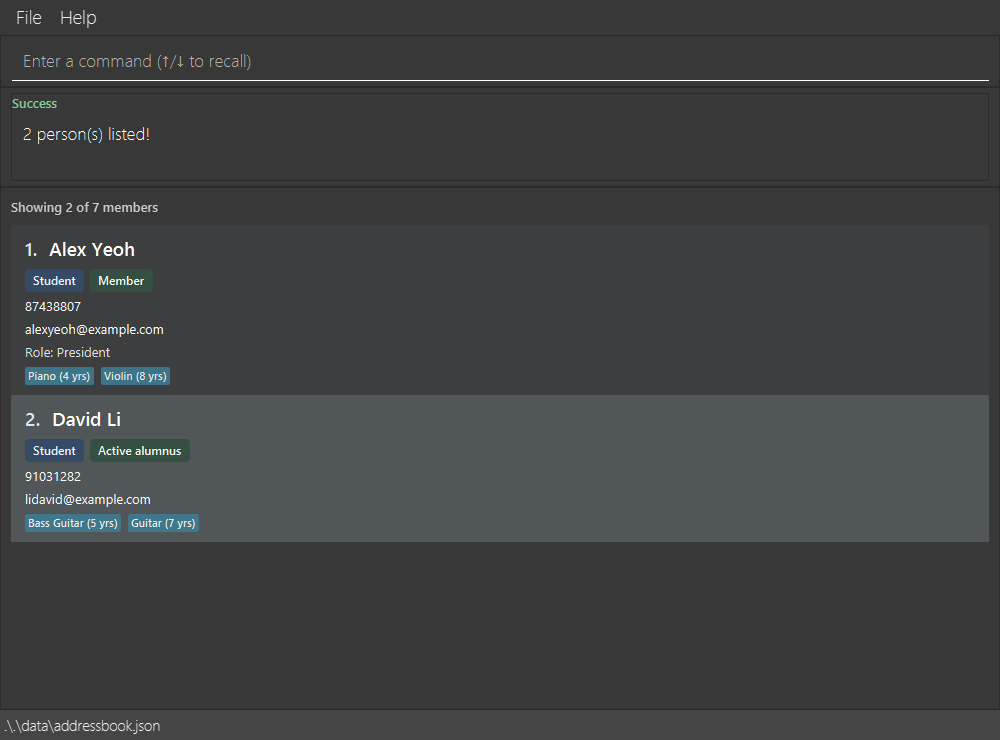

HiveMind is a **desktop directory for Music CCA members and alumni, optimized for use through a Command Line Interface (CLI)** while retaining the benefits of a Graphical User Interface (GUI). It helps coordinators view contact details, membership information, roles, and musical experience in one place. HiveMind is adapted from AddressBook Level 3 (AB3).

* Table of Contents
{:toc}

--------------------------------------------------------------------------------------------------------------------

## Quick start

1. Ensure that Java `25` or later is installed on your computer.<br>
   **Mac users:** Ensure you have the precise JDK version prescribed [here](https://se-education.org/guides/tutorials/javaInstallationMac.html).

1. Download the latest `.jar` file from the [HiveMind releases page](https://github.com/AY2627S1-CS2103T-T10-3/tp/releases).

1. Copy the file to the folder you want to use as the _home folder_ for HiveMind.

1. Open a terminal, `cd` to the folder containing the JAR file, and run `java -jar addressbook.jar`.<br>
   A GUI similar to the one below should appear in a few seconds. On first launch without a data file, the app contains sample records. The screenshot shows these sample records; existing saved records are loaded instead if a data file is present.<br>
   

1. Type a command in the command box and press Enter to execute it. For example, type **`help`** and press Enter to open the help window.<br>
   Some example commands you can try:

   * `list` : Shows all members and their recorded details.

   * `add n/John Doe p/98765432 e/johnd@example.com s/member` : Adds a current member named `John Doe`.

   * `delete 3` : Deletes the 3rd contact shown in the current list.

   * `clear` : Deletes all contacts.

   * `exit` : Exits the app.

1. Refer to the [Features](#features) section below for details of each command.

--------------------------------------------------------------------------------------------------------------------

## Features

<div markdown="block" class="alert alert-info">

**:information_source: Notes about the command format:**<br>

* Words in `UPPER_CASE` are the parameters to be supplied by the user.<br>
  For example, in `add n/NAME`, replace `NAME` with a value such as `John Doe`.

* Items in square brackets are optional.<br>
  For example, `n/NAME [r/ROLE]` can be used as `n/John Doe r/Section Leader` or as `n/John Doe`.

* Items followed by `…`​ can appear zero or more times.<br>
  For example, `[i/INSTRUMENT:YEARS]…​` may be omitted, or written as `i/Violin:5` or `i/Violin:5 i/Piano:2`.

* Parameters can be in any order.<br>
  For example, if the command specifies `n/NAME p/PHONE_NUMBER`, `p/PHONE_NUMBER n/NAME` is also acceptable.

* A parameter value cannot contain a space followed by another prefix of the same command, as HiveMind reads that as the start of a new parameter.<br>
  For example, `edit 1 r/Head g/Coach` sets the role to `Head` and the groups to `Coach`, and `edit 1 r/ n/a` removes the role and renames the person to `a`. Text such as `c/o` or `and/or` is fine, as it is not a prefix.

* Prefixes are lowercase. Prefixes from other address book apps, such as `t/` and `a/`, are not supported.

* Extraneous parameters for commands that take no parameters, such as `help`, `list`, `exit`, and `clear`, are ignored.<br>
  For example, `help 123` is interpreted as `help`.

* If you are using a PDF version of this document, be careful when copying and pasting commands that span multiple lines as space characters surrounding line-breaks may be omitted when copied over to the application.
</div>

### Viewing help: `help`

Shows a message explaining how to access the help page.


Format: `help`


### Adding a person: `add`

Adds a person to HiveMind.

Format: `add n/NAME p/PHONE_NUMBER e/EMAIL s/STATUS [ty/TYPE] [r/ROLE] [i/INSTRUMENT:YEARS]…​ [g/GROUP]…​`

* `s/STATUS` is required: use `member`, `active-alumnus`, or `inactive-alumnus`. Status is case-insensitive.
* `ty/TYPE` is optional: use `student` or `teacher`. It defaults to `student` when omitted.
* `r/ROLE` is optional free text, such as `Section Leader`. It cannot be blank. Extra spaces are removed, so `Vice   President` is saved as `Vice President`.
* Type and status appear beneath the member's name on the card. If a role is supplied, it appears beneath the contact details; otherwise, the role line is hidden.
* `i/INSTRUMENT:YEARS` records an instrument the person plays and how many whole years they have played it, from `0` to `99`. For example, `i/Violin:5` or `i/Bass Guitar:1`.
* Instrument names cannot be blank or contain `:`. Each instrument can be listed only once per person; names are compared ignoring case, so `Violin` and `violin` count as the same instrument.
* `g/GROUP` records a participation group, such as `g/Chamber Orchestra`. It may be repeated for multiple groups. Blank group names are rejected; names are compared ignoring case and extra whitespace, so repeated names are stored only once.
* Recorded groups appear in the command's success message and on the member card.

<div markdown="span" class="alert alert-primary">:bulb: **Tip:**
A person can have any number of instruments, including zero.
</div>

Examples:
* `add n/John Doe p/98765432 e/johnd@example.com s/member`
* `add n/Betsy Crowe p/1234567 e/betsy@example.com s/active-alumnus ty/teacher r/Conductor i/Violin:12 i/Piano:4`
* `add n/Jane Tan p/91234567 e/jane@example.com s/member g/Chamber Orchestra g/New Member Training`

### Importing people from a CSV file: `import`

Imports people from a CSV file in the `imports` folder. The imported people are added to the existing directory; import does not replace existing people.

Format: `import FILE_NAME`

Place the CSV file in `[JAR file location]/imports`, then provide its file name, including the `.csv` extension. For example, use `import members.csv` for `[JAR file location]/imports/members.csv`.

The CSV file must have this exact header and column order:

```text
name,phone,email,status,memberType,role,instruments,groups
```

Each subsequent row must have exactly these eight columns:

* `name`, `phone`, and `email` follow the same validation rules as `add`.
* `status` must be `member`, `active-alumnus`, or `inactive-alumnus`.
* `memberType` must be `student` or `teacher`.
* `role` and `groups` are optional. Represent an empty optional value with `""`.
* List multiple instruments as `NAME:YEARS` values separated by semicolons, for example `Violin:8;Piano:5`.
* List multiple groups separated by semicolons, for example `Orchestra;Leadership Team`.
* Within an instrument or group name, write `\;` for a literal semicolon and `\\` for a literal backslash. `export` applies these escapes automatically.

Example CSV file:

```csv
name,phone,email,status,memberType,role,instruments,groups
"Alicia Tan","91234567","alicia.tan@example.com","member","student","Section Leader","Violin:8;Piano:5","Orchestra;Leadership Team"
"Benjamin Lee","92345678","benjamin.lee@example.com","active-alumnus","teacher","","Cello:12",""
```

If any row has invalid data, does not contain eight columns, or duplicates an existing person or another CSV row, the entire import fails and the directory remains unchanged.

Example: `import members.csv`

### Listing all persons: `list`

Shows all members and alumni in the directory, in insertion order. Use this command after `find` or `filter` to return to the full list. It also clears any ordering selected with `sort`.

Format: `list`

Each member card displays:

* The member's displayed index and name.
* Member type (`student` or `teacher`) and membership status (`member`, `active-alumnus`, or `inactive-alumnus`).
* Phone number and email address.
* A `Role:` line when a role is recorded. No role line is shown when it is absent.
* Recorded instruments and their years of experience, sorted alphabetically by instrument name, ignoring case. For example, `Piano (5 yrs)` and `Violin (1 yr)`. No instrument labels appear when none are recorded.
* A `Groups:` line listing participation groups alphabetically when any are recorded. No groups line is shown when none are recorded.

The same card details are shown in `find` and `filter` results. Displayed indices start at `1` and refer to the current list, so a member's index may change after a search, filter or sort. Use the current displayed index for commands such as `edit` and `delete`.

Example: after `find alex david`, enter `list` to show everyone again. The result message is `Listed all persons.`

### Editing a person: `edit`

Edits an existing person in HiveMind.

Format: `edit INDEX [n/NAME] [p/PHONE_NUMBER] [e/EMAIL] [s/STATUS] [ty/TYPE] [r/ROLE] [i/INSTRUMENT:YEARS]…​ [g/GROUP]…​`

* Edits the person at the specified `INDEX`. The index refers to the index number shown in the displayed person list. The index **must be a positive integer** 1, 2, 3, …​
* At least one of the optional fields must be provided.
* Existing values will be updated to the input values.
* `s/STATUS` and `ty/TYPE` accept the same values as in `add`: `member`, `active-alumnus`, or `inactive-alumnus` for status, and `student` or `teacher` for type, ignoring case.
* `r/ROLE` replaces the person's role. To remove the role, enter `r/` without a role after it.
* Fields that are not specified are preserved. For example, editing a person's status keeps their contact details, type, role, instruments, and groups.
* Instruments are preserved when they are not edited.
* When editing instruments, all of the person's existing instruments are replaced; adding instruments is not cumulative.
* To remove all of a person's instruments, enter `i/` without an instrument after it.
* When editing groups, all existing groups are replaced by the supplied `g/GROUP` values. To remove all groups, enter `g/` alone. Mixing an empty `g/` with named groups is invalid.
* After an edit, the full member list is shown, even if the list was showing the results of `find` or `filter`. Run the `find` or `filter` command again to return to those results.

Examples:
*  `edit 1 p/91234567 e/johndoe@example.com` Edits the phone number and email address of the 1st person to be `91234567` and `johndoe@example.com` respectively.
*  `edit 2 n/Betsy Crower i/` Edits the name of the 2nd person to be `Betsy Crower` and clears all existing instruments.
*  `edit 3 i/Cello:6 i/Piano:2` Replaces the instruments of the 3rd person with Cello (6 years) and Piano (2 years).
*  `edit 1 s/active-alumnus r/` Marks the 1st person as an active alumnus and removes their role.
*  `edit 4 ty/teacher r/Conductor` Changes the 4th person's type to teacher and their role to `Conductor`.
*  `edit 2 g/Chamber Orchestra g/Training` Replaces the 2nd person's groups.
*  `edit 2 g/` Removes all groups from the 2nd person.

### Sorting displayed members: `sort`

Orders the currently displayed members without changing which members are shown or the order saved in the data file.

Format: `sort name` or `sort status`

* `sort name` orders names alphabetically, ignoring case and treating repeated whitespace as a single space. Names are displayed and saved as entered. Names with the same comparison key retain their original directory order.
* `sort status` groups members in this order: member, active alumnus, inactive alumnus. Within each status, members retain their original directory order.
* The attribute (`name` or `status`) is case-insensitive. Exactly one attribute is required; unsupported attributes or extra arguments show the usage message.
* Sorting works on the full directory and on `find` or `filter` results, including empty results.
* Subsequent `find` and `filter` commands retain the selected ordering. Adding or editing a member also retains the ordering, while showing the full directory.
* Use the updated displayed indices for `edit` and `delete`.
* `list` restores the full directory in insertion order. Restarting also resets the ordering; the sorting preference is not saved.

Examples:

* `sort name` sorts the current results by name. The success message is `Sorted displayed members by name.`
* Run `find alex david`, then `sort status` to group the matching members by membership status. The success message is `Sorted displayed members by status.`
* Run `sort name`, then `sort status` to switch ordering. Members with the same status return to their original directory order; the previous name ordering is not used as a secondary sort.

### Locating persons by name: `find`

Finds persons whose names contain any of the given keywords, including partial words.

Format: `find KEYWORD [MORE_KEYWORDS]…`

* The search is case-insensitive; for example, `hans` matches `Hans`.
* Keyword order does not matter; for example, `Hans Bo` matches `Bo Hans`.
* The search considers only names.
* Keywords can match any part of a name; for example, `ali` and `lic` both match `Alice`.
* Persons matching at least one keyword are returned (an `OR` search); for example, `Hans Bo` returns `Hans Gruber` and `Bo Yang`.
* Matching cards retain all recorded details and are numbered from `1`. The result message reports the number of matches. If nothing matches, the list is empty.
* Use `list` to display everyone again.

Examples using the built-in sample records:

* `find ale` matches `Alex Yeoh`, demonstrating partial-name matching.
* `find alex david` matches `Alex Yeoh` and `David Li`. In the example directory below, these are the only matches, so the result is `2 person(s) listed!` with cards numbered `1` and `2`.



### Filtering persons by status, instrument, type, role, and group: `filter`

Format: `filter [s/STATUS]... [i/NAME[:MIN_YEARS]]... [ty/TYPE]... [r/ROLE]... [g/GROUP]...`

Shows people matching the specified criteria and reports the number of matches.

* At least one criterion is required. Each field is optional; an omitted field imposes no restriction.
* Introduce each member type with `ty/`: use `student` or `teacher`, ignoring case and surrounding whitespace. Repeated types use OR.
* Introduce each role with `r/`, for example `r/Section Leader`. Matches the complete role, ignoring case and extra whitespace; `r/Leader` does not match `Section Leader`. Repeated roles use OR.
* Blank or invalid types and blank roles are rejected. People without a role do not match an explicit role criterion.
* Introduce each participation group with `g/`, for example `g/Chamber Orchestra`. Matches the complete group name, ignoring case and extra whitespace; `g/Orchestra` does not match `Chamber Orchestra`.
* Groups use OR: `filter g/Chamber Orchestra g/Training` matches people belonging to either group or both. Repeated names count once. Blank group names are rejected, and people without groups do not match an explicit group criterion.
* Different fields use AND: `filter ty/teacher r/Conductor s/member i/Violin:3 g/Chamber Orchestra` matches member teachers who are conductors, have at least three years on violin, and belong to Chamber Orchestra.
* Introduce each status with `s/`: use `member`, `active-alumnus`, or `inactive-alumnus`, ignoring case and surrounding whitespace.
* Statuses are combined with OR: `filter s/member s/active-alumnus` matches current members or active alumni.
* Introduce each instrument name with `i/`. `i/Violin` matches anyone who plays violin, regardless of experience.
* Optionally specify minimum years: `i/Violin:3` matches people with **at least 3 years** on violin, including exactly 3. The minimum must be a whole number from 0 to 99; blank, negative, decimal, and out-of-range values are rejected.
* Invalid minimum years, such as `filter i/Violin:abc`, report: `Minimum years should be a whole number from 0 to 99`.
* The years must belong to the matching instrument: experience on piano cannot satisfy a violin threshold.
* Instruments are combined with OR: `filter i/Violin i/Viola` matches people who play either instrument or both.
* Each repeated instrument criterion is an alternative, even for the same name: `filter i/Violin:3 i/Violin:5` matches violin players with at least 3 years. A name-only criterion such as `i/Violin` accepts any years for that instrument.
* Status and instrument groups are combined with AND: `filter s/member s/active-alumnus i/Violin:3 i/Viola:5` matches people who are members or active alumni and have at least 3 years on violin or at least 5 years on viola.
* Matches complete instrument names, ignoring case: `guitar` matches `Guitar`, but not `Bass Guitar`.
* Spaces after `i/` and around `:` are allowed: `filter i/ Violin : 3` is equivalent to `filter i/Violin:3`.
* Supported prefixes are `s/`, `i/`, `ty/`, `r/`, and `g/`. Other member-field prefixes such as `n/`, `p/`, or `e/` are rejected with the command format.
* Searches the full directory, including after a previous `find` or `filter`.
* If no person matches, the displayed list is empty and the result reports zero matches.
* Stored records are unchanged. Use `list` to display everyone again.

Examples:

* `filter g/Chamber Orchestra`
* `filter s/member i/Violin:3 g/Chamber Orchestra`

### Exporting current results: `export`

Exports the members currently shown in the list to a CSV file.

Format: `export`

* Exports the current displayed results. Run `find` or `filter` first to export only matching members; run `list` first to export everyone.
* Creates a CSV file in the `exports` folder inside HiveMind’s home folder.
* Each export receives the first unused numbered filename: `current-results-01.csv`, then `current-results-02.csv`, and so on. Existing export files are not overwritten.
* The CSV contains these columns: name, phone, email, status, member type, role, instruments, and groups.
* A member with multiple instruments or groups has them recorded in one field, separated by semicolons.
* A semicolon within an instrument or group name is escaped as `\;`, and a backslash as `\\`.
* Exporting an empty result list still creates a CSV file containing the column headers.

Examples:

* `find alex` followed by `export` exports the members whose names contain `alex`.
* `filter s/member i/Violin` followed by `export` exports the current members who play violin.

### Deleting a person: `delete`

Deletes the specified person from HiveMind.

Format: `delete INDEX`

* Deletes the person at the specified `INDEX`.
* The index refers to the index number shown in the displayed person list.
* The index **must be a positive integer** 1, 2, 3, …​

Examples:
* `list` followed by `delete 2` deletes the 2nd person in the member list.
* `find Betsy` followed by `delete 1` deletes the 1st person in the results of the `find` command.

### Clearing all entries: `clear`

Clears all entries from HiveMind.

Format: `clear`

### Undoing changes: `undo`

Reverts the most recent changes made by `add`, `edit`, `delete`, `clear` or `import`.

Format: `undo [COUNT]`

* Reverts the `COUNT` most recent changes, most recent first. Without `COUNT`, only the most recent change is reverted.
* `COUNT` must be a positive integer, e.g. 1, 2, 3, …​
* You can undo changes back to when HiveMind was started. If fewer than `COUNT` changes can be undone, nothing is undone and HiveMind tells you how many can be, or that there is no change to undo.
* Commands that do not change data (e.g. `list`, `find`, `filter`, `sort`, `export`) are not undone.
* An `import` is a single change, so `undo` removes everyone it added.
* After an undo, the full member list is shown.

Examples:
* `delete 2` followed by `undo` restores the deleted person.
* `delete 1`, then `delete 1` again, then `undo 2` restores both deleted people.

### Redoing undone changes: `redo`

Restores the most recent changes reverted by `undo`.

Format: `redo [COUNT]`

* Restores the `COUNT` most recently undone changes. Without `COUNT`, only the most recently undone change is restored.
* `COUNT` must be a positive integer, e.g. 1, 2, 3, …​
* Changes are restored in the reverse order of undoing: the most recently undone change comes back first.
* If fewer than `COUNT` undone changes can be restored, nothing is redone and HiveMind tells you how many can be, or that there is no undone change to redo.
* Once you make a new change (e.g. `add`, `edit`, `delete`, `clear` or `import`) after an `undo`, the undone changes can no longer be redone. This also applies to an `edit` that leaves the member's details unchanged.
* After a redo, the full member list is shown.

Examples:
* `delete 2`, then `undo`, then `redo` deletes the person again.
* `delete 1`, then `delete 1`, then `undo 2`, then `redo` deletes only the first of the two people again.

### Exiting the program: `exit`

Exits the program.

Format: `exit`

### Saving the data

HiveMind automatically saves every successful change to member data. Commands that do not change member data, such as
`list`, `find`, `filter`, `sort`, `help`, `export` and `exit`, do not rewrite the member data file. Preferences are saved
separately when HiveMind starts and exits. You do not need to save manually.

### Editing the data file

HiveMind data is saved automatically as a JSON file `[JAR file location]/data/addressbook.json`. Advanced users are welcome to update data directly by editing that data file.

<div markdown="span" class="alert alert-warning">:exclamation: **Caution:**
If your changes make the data file invalid, HiveMind starts with an empty directory at the next run, creates a numbered backup alongside it (e.g., `addressbook.json.bak-01`, followed by `addressbook.json.bak-02` if another backup is needed), and prevents directory changes from being saved. Repair or restore the original data file before restarting the app.<br>
Furthermore, certain edits can cause HiveMind to behave in unexpected ways (e.g., if a value entered is outside of the acceptable range). Therefore, edit the data file only if you are confident that you can update it correctly.
</div>

### Archiving data files `[coming in v2.0]`

_Details coming soon ..._

--------------------------------------------------------------------------------------------------------------------

## FAQ

**Q**: How do I transfer my data to another computer?<br>
**A**: Close HiveMind on both computers. Copy the `data` folder from the folder where you run HiveMind on the old
computer into the folder where you will run HiveMind on the new computer. If the new installation does not have a
`data` folder yet, copy the old folder there directly; you do not need to start HiveMind first.

--------------------------------------------------------------------------------------------------------------------

## Known issues

1. **When using multiple screens**, if you move the application to a secondary screen, and later switch to using only the primary screen, the GUI will open off-screen. The remedy is to delete the `preferences.json` file created by the application before running the application again.
2. **If you minimize the Help Window** and then run the `help` command (or use the `Help` menu, or the keyboard shortcut `F1`) again, the original Help Window will remain minimized, and no new Help Window will appear. The remedy is to manually restore the minimized Help Window.
3. **If you put the JAR file in a write-protected folder** (a folder where you cannot create files), HiveMind may fail to start, or may be unable to save your changes. The remedy is to move the JAR file to a folder you can write to, such as a new folder in your home folder, and start it from there.
4. **Double-clicking the JAR file may not start HiveMind**, or may start it with a different Java version, on some systems. The remedy is to start it from a terminal with `java -jar`, as described in the [Quick start](#quick-start).
5. **On macOS, if the main window is in full-screen mode**, the Help Window may open in a separate full-screen space or behind the main window. The remedy is to exit full-screen mode (e.g. press `Ctrl`+`Cmd`+`F`) before running `help`.

--------------------------------------------------------------------------------------------------------------------

## Command summary

Action | Format, Examples
--------|------------------
**Add** | `add n/NAME p/PHONE_NUMBER e/EMAIL s/STATUS [ty/TYPE] [r/ROLE] [i/INSTRUMENT:YEARS]…​ [g/GROUP]…​` <br> e.g., `add n/James Ho p/22224444 e/jamesho@example.com s/member g/Chamber Orchestra`
**Clear** | `clear`
**Delete** | `delete INDEX`<br> e.g., `delete 3`
**Edit** | `edit INDEX [n/NAME] [p/PHONE_NUMBER] [e/EMAIL] [s/STATUS] [ty/TYPE] [r/ROLE] [i/INSTRUMENT:YEARS]…​ [g/GROUP]…​`<br> e.g., `edit 2 n/James Lee g/Chamber Orchestra`
**Export** | `export`
**Find** | `find KEYWORD [MORE_KEYWORDS]…`<br> e.g., `find alex david`
**Filter** | `filter [s/STATUS]... [i/NAME[:MIN_YEARS]]... [ty/TYPE]... [r/ROLE]... [g/GROUP]...`<br> e.g., `filter s/member i/Violin:3 g/Chamber Orchestra`
**List** | `list`
**Sort** | `sort name` or `sort status`
**Undo** | `undo [COUNT]`<br> e.g., `undo 2`
**Redo** | `redo [COUNT]`<br> e.g., `redo 2`
**Help** | `help`
**Import** | `import FILE_NAME`<br> e.g., `import members.csv`
