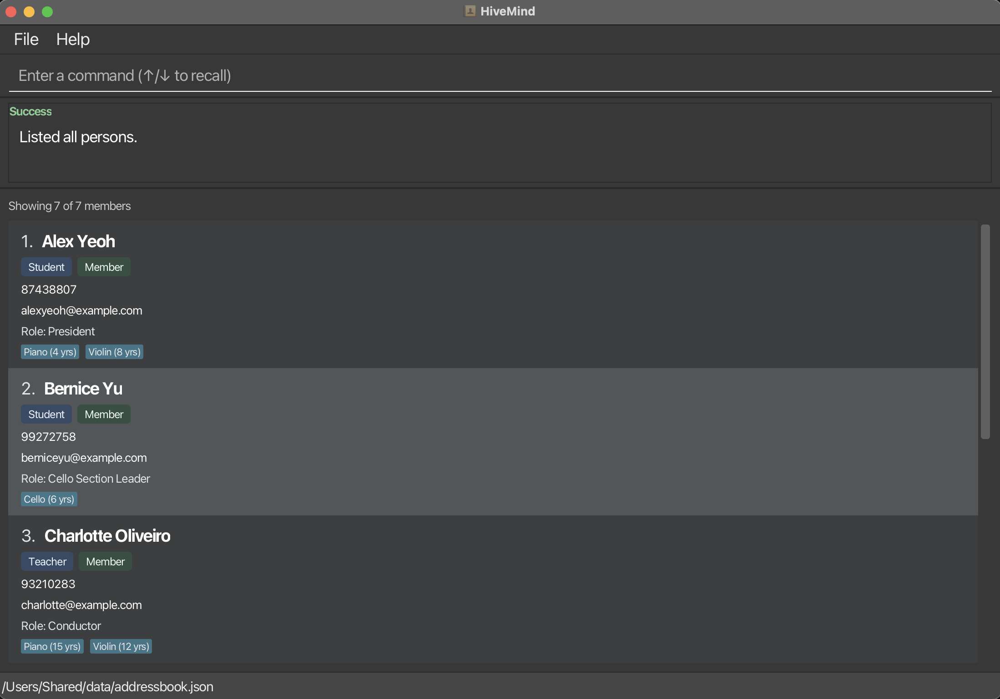

**HiveMind is a fast, keyboard-driven desktop directory for coordinators of music CCAs.** It keeps the contact details, membership information, and musical experience of students and teachers, including current members and alumni, in one place while presenting their records through a graphical interface.

Users can add, edit, delete, and list member records. Each record contains a name, phone number, email address, member type, membership status, an optional role, instruments with years of experience, and participation groups. Users can find known members, sort displayed records by name or status, or filter by status, member type, role, participation group, instrument, and minimum years of experience to shortlist suitable players for a piece or activity.

HiveMind also supports undoing and redoing multiple recent changes, recalling recent command submissions with the Up and Down arrow keys, importing members in bulk from CSV, and exporting selected fields from the currently displayed results to CSV. Successful changes are saved automatically, with backup, recovery, and rollback safeguards when data cannot be loaded or saved. Built-in help provides quick access to usage instructions.

* To use HiveMind, see the [_Quick Start_ section of the **User Guide**](UserGuide.html#quick-start).
* To develop HiveMind, see the [**Developer Guide**](DeveloperGuide.html).

**Acknowledgements**

* This project is based on the AddressBook-Level3 project created by the [SE-EDU initiative](https://se-education.org).
* Libraries used: [JavaFX](https://openjfx.io/), [Jackson](https://github.com/FasterXML/jackson), [JUnit5](https://github.com/junit-team/junit5)
